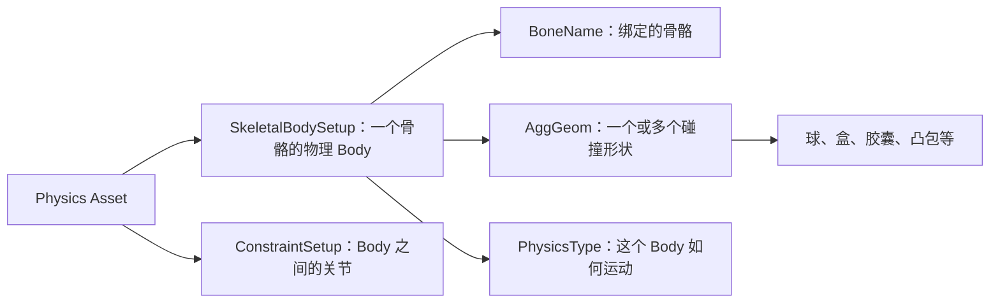

# 形体
“形体”，通常指一个**绑定到骨骼的物理刚体（Body）**

## Physics Type(物理类型)

| 类型                 | 如何确定 Body 的运动   | 能否被重力、冲量和碰撞推动               | 典型用途                       |
| ------------------ | --------------- | --------------------------- | -------------------------- |
| **Default（默认）**    | 继承所属组件的模拟设置     | 取决于组件是否启用模拟                 | 希望这个 Body 随整体角色在动画与布娃娃之间切换 |
| **Kinematic（运动学）** | 由动画、组件变换或程序指定位置 | **不能**被物理力推动，但仍可与模拟刚体发生物理交互 | 固定骨盆或躯干，作为其他模拟肢体的支点        |
| **Simulated（模拟）**  | 由物理解算器计算位置和速度   | **可以**受重力、碰撞、约束、力和冲量影响      | 布娃娃的手臂、腿、躯干等               |
这里的“运动学”**不是没有碰撞**。例如运动学手臂按动画移动时，可以挡住或推动一个模拟中的物体；只是物体的反作用力不会把这条运动学手臂推走。反过来，Simulated 手臂碰到墙会被墙挡住，其最终位置可能偏离动画姿态。

| Body 的 Physics Type | 组件未启用模拟      | 组件启用模拟  |
| ------------------- | ------------ | ------- |
| Default             | 通常随动画，表现为运动学 | 参与物理模拟  |
| Kinematic           | 保持运动学        | 仍指定为运动学 |
| Simulated           | 指定为模拟        | 指定为模拟   |
Physics Type 主要影响**刚体的运动来源和是否参与动力学求解**：谁决定它的位置、重力/冲量能否推动它、关节另一端是动态物体还是运动学支点。它**不等于**碰撞开关，也不直接定义形状、质量、摩擦或关节角度限制；这些分别由碰撞几何、Body Instance、物理材质和 Constraint 等设置负责。源码将 `PhysicsType` 与 `CollisionReponse` 分列为属性，也将碰撞形状存于 `AggGeom`。见 [BodySetupCore.h (line 27)](E:/UEProject/UE_5.8/Engine/Source/Runtime/PhysicsCore/Public/BodySetupCore.h:27)、[BodySetup.h (line 158)](E:/UEProject/UE_5.8/Engine/Source/Runtime/Engine/Classes/PhysicsEngine/BodySetup.h:158)。
- **是否模拟**：Body 是动力学的还是运动学的。
- **Physics Blend Weight**：最终骨骼显示姿态混合多少物理结果。它不是碰撞强度，也不是 Physics Type。`SetPhysicsBlendWeight` 还会自动切换模拟状态；如果想明确控制单个 Body，组件另提供 `SetBodySimulatePhysics`、`SetAllBodiesBelowSimulatePhysics` 等 API。见 [SkeletalMeshComponent.h (line 2342)](E:/UEProject/UE_5.8/Engine/Source/Runtime/Engine/Classes/Components/SkeletalMeshComponent.h:2342)。